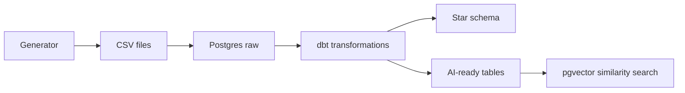
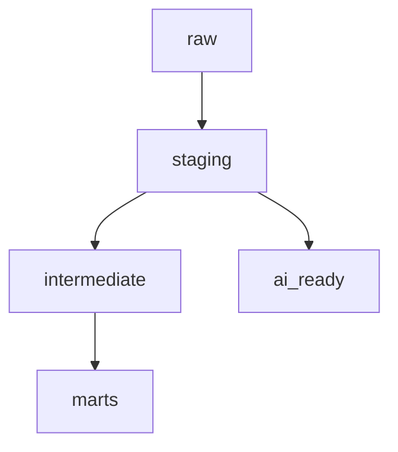
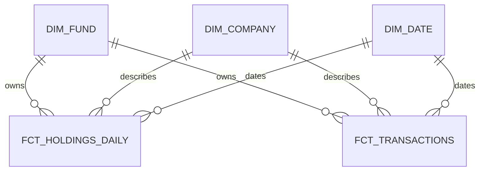
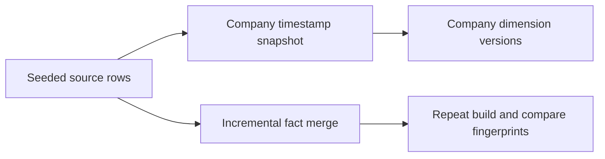

# Architecture

All sources and outputs in this prototype are synthetic. The diagrams below are Mermaid source files under `docs/diagrams/`; PNG export is provided by `scripts/export_diagrams.ps1`.

## 1. End-to-end flow



Source: [`end_to_end.mmd`](diagrams/end_to_end.mmd).

## 2. dbt layers



Source: [`dbt_layers.mmd`](diagrams/dbt_layers.mmd).

## 3. Star schema



Source: [`star_schema.mmd`](diagrams/star_schema.mmd).

## 4. Incremental facts and SCD Type 2



Source: [`incremental_scd2.mmd`](diagrams/incremental_scd2.mmd). Transactions reprocess a 90-day ingestion-time window on each incremental build. A delayed row inside that overlap is merged by its stable transaction key. Company snapshots track `ingested_at`; old versions receive a `dbt_valid_to` and one current version remains open-ended.

## 5. AI-ready retrieval

```mermaid
flowchart LR
  NOTES[Synthetic notes] --> CHUNKS[ai_text_chunks]
  CHUNKS --> EMBED[8-dimensional vectors]
  EMBED --> INDEX[HNSW cosine index]
  QUERY[Query] --> SEARCH[search_similar(query, k)]
  INDEX --> SEARCH
  SEARCH --> RESULTS[Chunks plus provenance]
```

Source: [`retrieval_flow.mmd`](diagrams/retrieval_flow.mmd). Default vectors are deterministic test-only pseudo-vectors. They validate plumbing and ranking mechanics, but carry no semantic meaning. Optional API embeddings use the same 8 dimensions and require a user-supplied key.

## PostgreSQL layout

| Schema | Contents |
| --- | --- |
| `raw` | Generated seed tables |
| `staging` | Typed, de-duplicated rows; orphan keys are removed by valid-key joins |
| `intermediate` | Enriched holdings and transactions |
| `marts` | `dim_fund`, SCD2 `dim_company`, `dim_date`, and two incremental facts |
| `ai_ready` | PII-free company profiles and provenance-rich note chunks |
| `snapshots` | dbt-managed company history |

Schemas are set by [`generate_schema_name.sql`](../macros/generate_schema_name.sql). The dbt profile is generated outside the repository at runtime. The Compose initialization script and dbt `on-run-start` ensure the pgvector extension exists.

## Data-quality controls

The project applies standard dbt uniqueness, null, relationship, and accepted-value tests, source freshness, model contracts on all five marts, a latest-day holdings-to-NAV tolerance check, a no-future-valuations check, and a one-current-company check. The pipeline builds twice and compares deterministic checksums and counts for both facts. The pytest suite exercises generator reproducibility, defects, runner orchestration, model contracts, the SCD2 configuration, the vector query, and the firm-neutral content scan.
