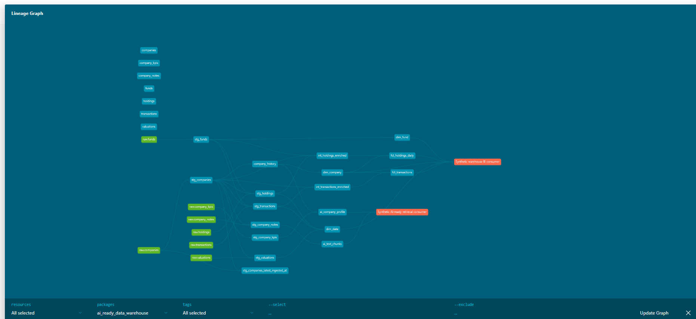
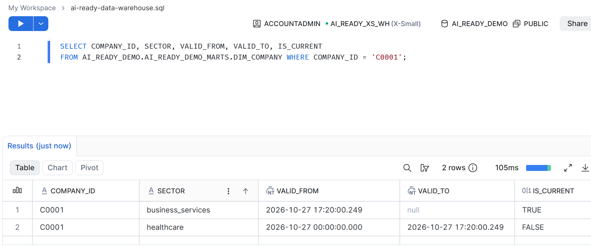
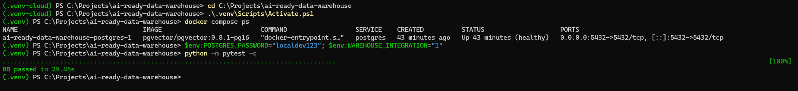
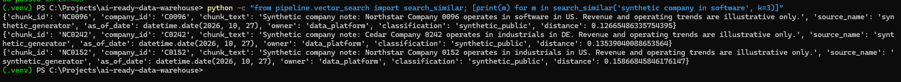

# Case study: synthetic investment portfolio data to retrieval-ready context

## Problem

Investment portfolio reporting often brings together fund reference data, holdings, deal transactions, valuations, company operating indicators, and narrative notes. These sources have different grains and update patterns. A daily holding is not the same kind of event as a transaction, while a company sector can change over time. A downstream analyst needs repeatable totals and a way to trace each number to a consistent model. An AI application also needs concise context with source and date metadata, without exposing direct personal information.

This project is designed to demonstrate those engineering patterns with generated, fictional records. It does not use real client, company, employer, or fund information and makes no claim of production use. The intended local execution target is PostgreSQL 16 with pgvector, with dbt managing transformations and tests. The local end-to-end pipeline has completed successfully; see [`FINDINGS.md`](../FINDINGS.md) for its dated result.

## Data and generation

The generator creates eight funds and a configurable portfolio company set (400 by default). It also creates daily position rows, transactions, dated valuations, revenue-growth and margin KPIs, and short company notes. Company groups are synthetic. A fixed random seed and date make runs repeatable. By default, 30 days of holdings keep the local database modest; `--days` and `--companies` increase the volume for experiments.

The inputs deliberately include a repeated holding, an orphan company reference, one late-ingested transaction, and a company attribute version whose ingestion time is initially one day in the future. Staging deduplicates stable source keys and joins valid company/fund references. The runner captures the baseline snapshot first, promotes that future-dated row, reloads the seeds, and builds again so the timestamp snapshot can open a second SCD2 version.

## Design

The pipeline uses ELT: generated CSV files are loaded as raw dbt seeds, and SQL models do the type casting, deduplication, enrichment, and dimensional modeling inside Postgres. The staging layer removes invalid references, the intermediate layer enriches holdings and transactions, and the marts expose two facts with fund, company, and date dimensions. Each mart has a dbt model contract. Company history is snapshot-backed and carries parent group identifiers.

*Synthetic data: dbt docs lineage graph for the local PostgreSQL build.*

The holdings fact is configured to merge keyed by holding ID and reprocess a 30-day date overlap. Transactions use merge keyed by transaction ID and re-read a 90-day ingestion overlap so a late record with an old business date can be incorporated. The runner first uses `dbt build` to create staging and the baseline snapshot in DAG order. It then promotes and reloads the generated company change, runs another build to create its SCD2 version, verifies that two versions and one current row exist, and runs one more build for the fact checksum idempotency comparison. The verified local run results are recorded in [`FINDINGS.md`](../FINDINGS.md). Changes arriving outside the documented window require a full refresh.

*Synthetic data: Snowflake `dim_company` shows two C0001 versions; the old closes at 17:20:00.249 UTC as the new opens, with one current row.*

Configured data controls include dbt source freshness, standard uniqueness/null/relationship/value tests, holdings reconciliation against the latest daily NAV snapshot with a 25% illustrative tolerance, a future valuation check, and a single-current-company check. The pytest suite contains checks for deterministic generation, defect creation, project contracts, runner order, vector-search behavior, and firm-neutral content. The local suite passed; its recorded result is in [`FINDINGS.md`](../FINDINGS.md). Synthetic records and rules are examples, not investment advice or business controls.

*Synthetic data: full pytest suite result with integration tests enabled.*

## AI-ready layer

`ai_company_profile` presents selected non-PII attributes and source lineage. `ai_text_chunks` contains short note text with source, as-of date, owner, and classification. PostgreSQL stores an 8-dimensional pgvector column and an HNSW cosine index. The default vectors derive deterministically from text hashes and are **test only; not semantic**. They demonstrate load/index/query wiring but do not establish retrieval quality. An optional OpenAI provider is available behind an explicit CLI flag and an environment variable. It can incur API charges and is not needed for CI.

The search demo returns the top `k` note chunks with provenance metadata, as shown in the saved result. A consuming application could pass that context to a language model, but this project does not include an LLM call, prompt, or answer-quality evaluation. The embeddings are deterministic test vectors, not semantic.

*Synthetic data: pgvector top-3 result; embeddings are deterministic test vectors, not semantic.*

## Platform comparison and results

The local PostgreSQL, Snowflake, and Databricks run results are recorded in [`FINDINGS.md`](../FINDINGS.md). The reported platform timings reflect different service tiers and include serverless warehouse startup for Databricks, so they are not a like-for-like benchmark.

The Snowflake setup uses an XS auto-suspending warehouse, staged loads, a resource monitor when permitted, and holdings clustering. Snowflake offers managed warehouse operations and micro-partition pruning; clustering maintenance and compute can still cost money. The Databricks setup uses Delta tables and a serverless SQL warehouse, with liquid clustering. Unity Catalog tag emission is opt-in by edition and permission. These configurations are not measured comparisons; see the runbooks, [cloud vector search notes](CLOUD_VECTOR_SEARCH.md), and [`FINDINGS.md`](../FINDINGS.md) for setup and result status.

## Trade-offs and limitations

PostgreSQL is the configured local target, and pgvector keeps retrieval data beside warehouse tables. It does not validate cloud-specific semantics. The small generated dataset is intended for tests, but does not establish performance at millions of rows. The 8D test vectors are deliberately compact and have no semantic quality. The synthetic ownership, NAV tolerance, and classification values are illustrative. The 90-day and 30-day incremental overlaps are bounded. The model uses a current company key for facts rather than a complete as-of dimension lookup. Cloud security, cost, and performance remain unvalidated until Phase 2.

## How to reproduce

From a clean checkout, install the pinned Python dependencies and the editable repository package, set `POSTGRES_PASSWORD` in the PowerShell environment, start Compose, run `python pipeline/run.py --target postgres`, and then run `pytest -q`. The README contains the exact commands and shutdown steps. CI is configured for the same Postgres-only path with integration tests enabled. Neither CI nor the local end-to-end path has been verified from this environment. The generated CSVs and dbt build artifacts are ignored by Git.
